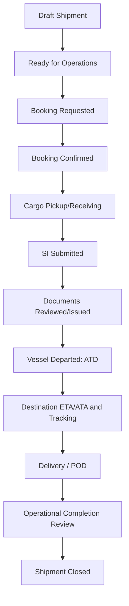
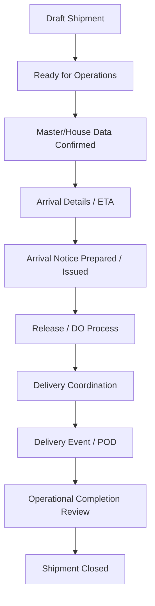

# Shipment Lifecycle — Cargo FMS

## 1. Core principle
Do not use one giant status field to represent every operational fact. A shipment lifecycle status is a coarse summary; detailed execution is recorded as milestones, events, booking states, document states, exceptions and billing states.

## 2. Recommended shipment lifecycle (coarse)
```text
Draft → Ready for Operations → Active → Operationally Completed → Closed
   ↘ Cancelled (guarded transition)
```

Definitions:
- **Draft:** shipment created, information incomplete; editable within permissions.
- **Ready for Operations:** required handoff data checked and operational ownership assigned.
- **Active:** operational execution underway; bookings, cargo, documents and milestones can progress.
- **Operationally Completed:** required execution milestones reached or exception approved; POD/arrival/release conditions reviewed depending on service.
- **Closed:** operational close checklist completed and authorized. Financial closure is separate.
- **Cancelled:** cancelled with reason; linked bookings/documents/charges handled through their own cancellation rules.

Avoid a generic `In Progress` status if it is unclear. `Active` is the coarse state; actual progress comes from events.

## 3. Separate lifecycles
A Shipment has related records with their own state:
- Booking: Draft → Requested → Confirmed → Amended / Cancelled / Rejected
- Document: Draft → Review → Approved → Issued → Amended / Cancelled / Superseded
- Charge: Draft → Reviewed → Approved/Ready to Bill → Partly Billed / Billed / Cancelled
- Billing document: Draft → Pending Approval → Approved → Issued → Voided/Adjusted (policy-dependent)
- Receivable/payable: Open → Partly Settled → Settled; overdue is calculated, not necessarily a state
- Exception: Open → Assigned → Resolved → Closed
- Shipment closure: Checklist → Review → Closed; reopen by authorized action and reason

## 4. Readiness checklist
Before moving from Draft to Ready for Operations, validate minimum information by service:
- Shipment number
- Direction, mode and service
- Customer/partner
- Owner (operations)
- Origin/destination or service location
- Cargo summary (for cargo-based service)
- Requested schedule/date or explanation if unknown
- Source quotation/order or manual-create reason
- Required instructions and references
Checklist should be configurable by service; do not require fields that are not applicable.

## 5. Events and milestones
Use an append-oriented event/milestone record with:
- Event type
- Planned/actual classification
- Timestamp (store consistently; timezone policy)
- Location
- Source (manual, carrier feed, integration, document)
- Actor (when known)
- External reference
- Notes
- Correction/reversal reference (avoid silently overwriting actual history)

Examples, service-dependent:
- Booking Requested / Confirmed
- Cargo Pickup
- Cargo Received at CFS
- SI Submitted
- Documentation Cutoff
- Cargo Cutoff
- Vessel ETD / ATD
- Vessel ETA / ATA
- Transshipment
- Customs/Release status (only as validated/available)
- Delivery Out
- Delivered
- POD Received

Planned schedule edits should create revisions/history. Actual events should be timestamped and not erased; correction records must preserve the original and reason.

## 6. Example Ocean Export FCL flow

Booking, documentation and milestones are separate records. Some services may skip or reorder steps.

## 7. Example Ocean Import FCL flow

Do not model customs clearance as automatically completed by Cargo FMS unless the system actually integrates with and receives authoritative clearance information.

## 8. Operational closure checklist
- Service-specific required milestones reached, or exceptions documented/approved
- Required documents issued/received or explicitly waived
- Cargo delivery/arrival outcome recorded
- POD attached/recorded when required
- Exceptions resolved or accepted by authorized user
- Shipment ownership and final status reviewed
- Closure reason, actor, and timestamp recorded

## 9. Financial closure is independent
Operational close must not automatically imply fully paid. Financial review may check:
- Revenue charges captured and billed
- Costs captured, received or accrued/estimated
- Profit reviewed
- AR/AP outstanding acknowledged
- Credit notes/adjustments reviewed
- Settlement status reported

A shipment may be Operationally Closed but Financially Open. Avoid a single `closed` flag that hides this distinction.

## 10. Cancellation, hold and reopening
- Cancel requires permission and reason.
- Cancelled shipment retains history.
- Related booking cancellation is a separate confirmed action or workflow.
- Issued documents cannot be silently deleted; void/amend/supersede rules apply.
- A shipment on hold remains identifiable and searchable; hold reason, owner and release action are recorded.
- Reopening a closed shipment requires permission, reason, audit, and a controlled transition.
