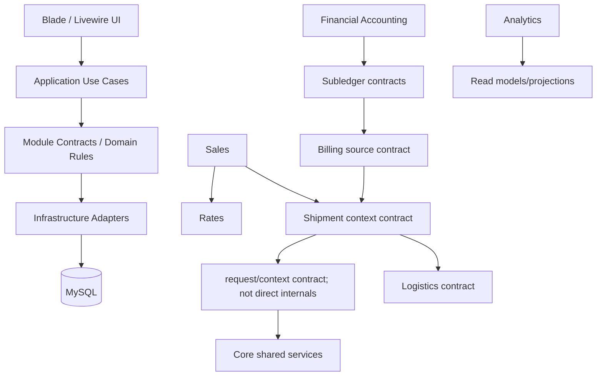

# Architecture Boundaries — Cargo FMS

## 1. Why boundaries matter
Cargo FMS contains operational, document, commercial and accounting workflows. Without ownership boundaries, screens tend to query and update many unrelated tables directly, producing tightly coupled logic and unsafe financial operations.

Use a modular monolith with internal boundaries. Each module owns its data, rules, application use cases, and public contracts.

## 2. Proposed module map and ownership
### Core Platform
Owns:
- Identity/authentication integration
- Organization/company/branch/department/team
- Access control, role/permission definitions and scope policy
- Business partner identity, role profiles, contact/address
- Shared reference data: locations, ports, airports, currencies, units, service catalogue
- Numbering, audit, notification, file/document infrastructure

Does not own:
- Quotation pricing rules
- Shipment execution rules
- Billing calculations
- Journal posting

### Sales
Owns:
- Leads/inquiries
- Customer/sales assignment
- Activities/follow-up
- Quotation and quotation revisions/lines
- Sales order/Shipping Order handoff
- Sales pipeline metrics

Calls:
- Rate module for quote lookup through contract
- Freight Operations handoff contract to create or request shipment

### Rates
Owns:
- Rate sheets, revisions, applicability conditions
- Buy/sell pricing lookup and validity
- Rate approval and history

Does not own:
- Quotation final state
- Shipment charges already captured
- Invoices

### Freight Operations
Owns:
- Shipment/job
- Shipment parties/cargo
- Booking
- Equipment/container assignment
- Routing legs and schedules linkage
- Operational milestones/events
- Consol and house-shipment association
- Operational exceptions and closure

Subdomains (start consolidated, separate namespaces):
- Ocean Import
- Ocean Export
- Consolidation/LCL
- Air Freight

### Documentation
Owns:
- Document templates and data mappings
- Document-specific lifecycle and revisions
- Generated snapshots/files and issue/amend/void/supersede metadata

Freight Operations provides document context via contract; Documentation does not directly mutate shipment state.

### Logistics
Owns:
- Transport orders, pickup/delivery task coordination
- Provider assignment, timing, status, cost/charge reference, POD

Initially does not own fleet telematics or route optimization.

### Billing
Owns:
- Shipment charge lines and charge workflow
- Revenue/cost capture
- Debit/credit/commission notes
- Billing source linking and duplicate prevention
- Shipment profitability calculations/read models

Does not own:
- Cash receipt/payment transactions
- General ledger posting

### Receivables & Payables
Owns:
- Customer/vendor open items
- Receivable/payable invoice balance
- Receipts and payments
- Allocations, partial settlement, aging, reconciliation

### Financial Accounting
Owns (later phase):
- COA, fiscal periods
- Journals and posting
- General ledger
- Trial balance
- Bank reconciliation
- Financial statements, tax outputs and accounting close

### Analytics
Owns:
- Governed metric definitions
- Reporting projections/read models
- Report queries and exports

Analytics must not become a second transactional source of truth.

## 3. Dependency direction


## 4. Boundary rules
1. Livewire components must not access Eloquent models, DB facade, or repositories directly.
2. Livewire calls a module Application Service/Action.
3. Application services coordinate use cases and transaction boundaries.
4. Domain rules/status transitions live in domain services/policies/value objects or focused application actions, not views.
5. Repository contracts are owned by the module that needs the capability.
6. Repository implementations use Eloquent and are bound through dependency injection.
7. Do not expose unrestricted Eloquent query builders across module boundaries.
8. Other modules read/write another module's data only through public application contracts or documented events.
9. Avoid synchronous chains that create circular module dependencies.
10. For cross-module workflows, orchestrate at application layer and use transactions carefully; for async reliability use outbox + idempotent consumers.
11. A module may have a dedicated read query/projection for its own screens.
12. Analytics uses approved projections/contracts and metric definitions; it cannot modify source records.
13. Issued/posted records require controlled reversal/amendment, not generic CRUD.
14. Shared Core must not become a dumping ground for domain logic.

## 5. Internal module structure (Laravel-oriented, illustrative)
```text
app/
  Core/
    Organization/
    Access/
    BusinessPartners/
    ReferenceData/
    Numbering/
    Audit/
    Documents/
    Notifications/
  Modules/
    Sales/
      Application/
      Domain/
      Contracts/
      Infrastructure/
      Presentation/
    Rates/
      Application/
      Domain/
      Contracts/
      Infrastructure/
    Freight/
      Shipment/
      Booking/
      OceanImport/
      OceanExport/
      Consolidation/
      Air/
    Documentation/
    Logistics/
    Billing/
    ReceivablesPayables/
    FinancialAccounting/
    Analytics/
  Shared/
    Money/
    Currency/
    Exceptions/
    Support/
```
This is a logical map. Do not create every empty folder at project bootstrap; scaffold modules as implementation starts.

## 6. Contract examples (conceptual)
Sales → Freight Operations:
- `CreateShipmentFromSalesOrder` / `ShipmentHandoffService`
- Input DTO contains accepted quotation revision, order ID, parties, cargo, routing and instructions.
- Returns shipment ID/number or a clear validation result.
- Idempotency key/source uniqueness prevents duplicate shipment creation.

Freight Operations → Documentation:
- Provide shipment/document context via query DTO.
- Documentation owns generation, revision, issue state and file storage metadata.

Freight Operations → Logistics:
- Request transport coordination with shipment reference, pickup/drop, time window, cargo details.
- Logistics returns transport order ID/status.

Freight Operations → Billing:
- Expose shipment context and relevant event/charge sources.
- Billing owns charge amounts and billing lifecycle.

Billing → AR/AP:
- Issue financial source creates receivable/payable open item through contract/event.
- AR/AP owns settlement/allocation.

AR/AP → Financial Accounting:
- Source documents produce posting requests via configured mapping.
- Financial Accounting validates and posts journals; it does not mutate source invoice records.

## 7. Event vs direct contract
Use direct application contracts for synchronous validation/result needed immediately. Use events/jobs for notifications, document generation, exports, integration calls and analytics refresh.

Potential events:
- QuotationAccepted
- SalesOrderHandedOff
- ShipmentCreated
- BookingConfirmed
- MilestoneRecorded
- DocumentIssued
- ChargeApproved
- BillingDocumentIssued
- InvoiceCreated
- ReceiptRecorded
- PaymentAllocated
- JournalPosted
- ShipmentOperationallyClosed

Events are facts, not commands. Consumers must tolerate duplicates and be idempotent.

## 8. Reporting boundary
Separate:
- Transactional detail (module-owned)
- Read model/report projections (Analytics or module query services)
- Export job (queue, permission-aware, audited)

For first release, reports can use optimized SQL/query services. Add reporting tables only after measured needs. Always apply branch/department/user scope before exporting.
