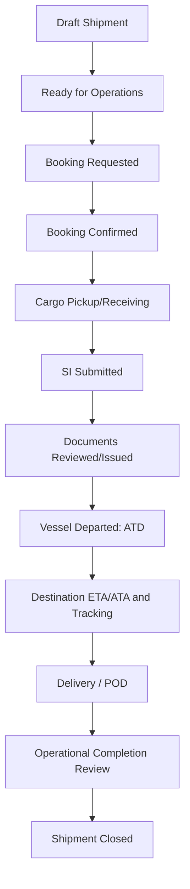
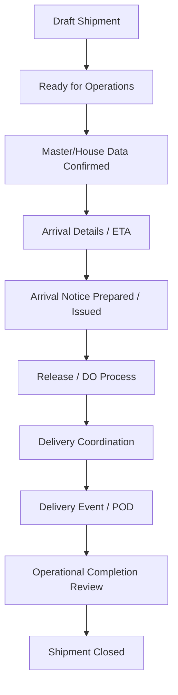
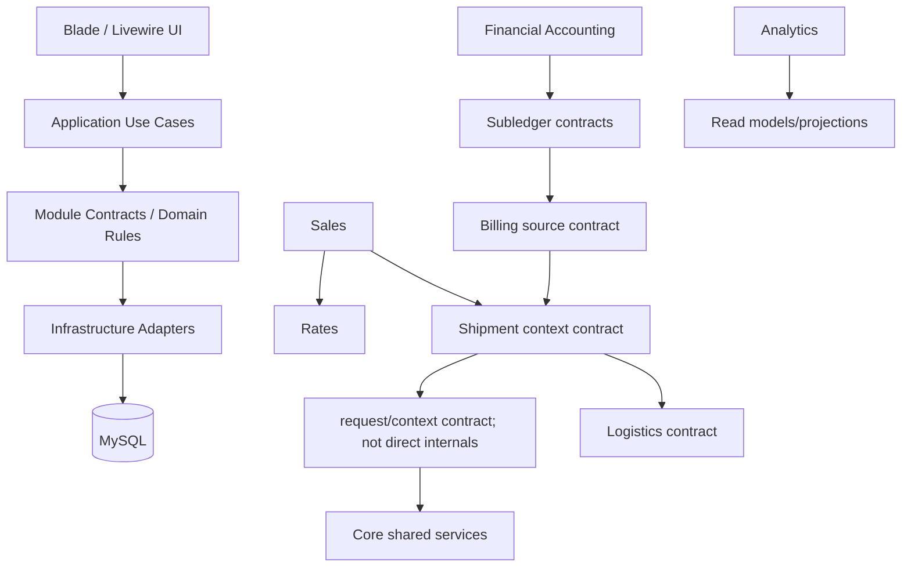

# Cargo FMS Architecture Baseline v2

# Included document: 00_DECISION_SUMMARY.md

# Decision Summary — Cargo FMS v2

## Proposed baseline decisions

| Area | Proposed decision | Status |
|---|---|---|
| Product | Freight Forwarding & Logistics Operations System | Baseline |
| Architecture | Modular Monolith | Adopt for initial build |
| Backend | Laravel | Adopt, verify version/package compatibility before pinning |
| UI | Blade + Livewire + Alpine + Tailwind | Adopt |
| DB | MySQL 8.x | Adopt as primary transactional database |
| Shipment | Core operational job record; not a universal owner of every domain | Adopt |
| Sales | Inquiry → Quotation revision → acceptance → Shipping Order handoff | Adopt |
| Freight | Inbound/Outbound Sea FCL first; LCL/Consol progressively; Air after core | Scope staged |
| Billing | Charges, Debit/Credit/Commission notes, shipment profitability before full GL | Adopt |
| Finance | AR/AP subledger and allocation before full financial accounting | Stage |
| Documents | Template + revision + issued snapshot; issued docs are not silently editable | Adopt |
| Integration | Adapter-based, queued, idempotent; official formats validated separately | Adopt |
| Multi-company | Company/branch/department-aware foundations; full SaaS tenancy not assumed | Validate target |
| Repo pattern | Application Services/Actions + Repository Contracts + Eloquent implementations | Adopt |
| Livewire rule | UI components must not access Eloquent or repositories directly | Adopt |

## Initial MVP vertical slice
Build a narrow end-to-end workflow:
**Customer & Partner → Rate/Quotation → Sales Order → Shipment → Booking/Events → Charges → Debit/Credit billing documents → Shipment Profit report.**

Avoid attempting all inbound/outbound/LCL/air/financial accounting screens at once.

## Guardrails
- Shipment records are operational and shipment-centric; billing/accounting are their own domains.
- A “status” field cannot replace milestone/event history.
- Business numbers are generated by a concurrency-safe numbering service.
- Money uses DECIMAL and explicit currency/exchange-rate/rounding policy.
- Issued quotation/document/invoice and posted journal preserve snapshots and history.
- Cross-module communication uses public application contracts and/or events.
- Each business workflow has a transaction boundary, authorization, audit, and tests.
- No microservices until a measurable reason exists.

---

# Included document: 01_BUSINESS_DOMAIN.md

# Business Domain — Cargo FMS

## 1. Product definition
Cargo FMS is an operational and commercial management system for freight-forwarding, NVOCC and logistics service businesses. It coordinates sales, pricing, shipment execution, shipping documents, charges, customer billing, vendor costs, settlement and reporting.

It is **not initially** a full customs-declaration platform, carrier network, warehouse management system, own-fleet TMS, or statutory accounting replacement.

## 2. Business operating model
Typical business flow:
1. Sales receives inquiry and confirms cargo/service requirements.
2. Sales prepares pricing based on sell rates and estimated buy costs.
3. Customer accepts a quotation or sends shipping instruction/order.
4. Sales hands over a structured Shipping Order to Operations/Documentation.
5. Operations opens and manages a Shipment/Job, booking, route, cargo, milestones and exceptions.
6. Documentation prepares and issues applicable shipping documents.
7. Charges and vendor costs are captured, checked, and billed.
8. Accounting tracks invoices, receipts/payments, open items, allocations and settlement.
9. Shipment is reviewed and closed operationally and/or financially under separate criteria.
10. Management analyzes volume, revenue, costs, profit, aging, service performance and sales performance.

## 3. Primary actors
- Sales Executive / Sales Representative
- Sales Supervisor / Manager
- Operations staff
- Documentation staff
- Logistics coordinator
- Billing staff
- Shipment accountant
- AR/AP accountant
- Financial accountant
- Finance manager
- Branch/department manager
- Management
- System administrator

External parties include customers, shippers, consignees, notify parties, shipping lines, airlines, overseas agents, co-loaders, vendors, trucking providers, warehouses/CFS, ports and airports.

## 4. Business Partner model
A single partner identity may have multiple roles. Do not create separate companies merely because an organization is both customer and vendor, or agent and co-loader.

### Partner roles
Customer, Shipper, Consignee, Notify Party, Agent, Co-loader, Carrier, Airline, Vendor, Trucking Provider, Warehouse/CFS Operator, Customs Service Partner.

Partner data:
- Legal/operating names and identifiers
- Contacts
- Addresses
- Role/profile information
- Payment terms and credit settings (where permitted)
- Tax and invoice attributes (subject to local validation)
- Active/inactive and risk/hold flags
- Ownership/assignment to sales team

## 5. Domain glossary
| Term | Meaning in Cargo FMS |
|---|---|
| Inquiry | Customer/prospect request for freight or logistics service |
| Quotation | Commercial offer with revision, validity, charges, terms and approval |
| Rate Sheet | Reusable buy/sell rates with applicability and effective dates |
| Shipping Order | Sales-to-operations handoff with confirmed service/cargo instructions |
| Shipment / Job | Operational file coordinating one cargo/service engagement |
| Booking | Reservation/request for transport capacity with provider |
| Transport Leg | A segment in route with mode/provider/locations/times |
| FCL | Full Container Load |
| LCL | Less-than-Container Load; consolidated handling |
| Consol | Consolidation/master movement grouping multiple house shipments |
| House B/L | House-level transport document issued by forwarder/NVOCC |
| Master B/L | Master-level document issued by carrier or master provider |
| HAWB / MAWB | House / Master Air Waybill |
| POL / POD | Port of Loading / Port of Discharge |
| ETD / ETA | Estimated departure / arrival |
| ATD / ATA | Actual departure / arrival |
| SI | Shipping Instruction |
| Cargo Manifest | Cargo summary for a movement/document |
| CFS | Container Freight Station |
| Arrival Notice | Notice of expected/actual cargo arrival |
| Delivery Order | Release/delivery instruction under applicable process |
| POD | Proof of Delivery |
| Charge | Revenue or cost item (freight, handling, docs, THC, etc.) |
| Debit Note | Document/record of charge billed to a customer/party |
| Credit Note | Credit/adjustment document; exact semantics depend on company workflow |
| Commission Note | Commission payable/receivable record under business rules |
| AR | Accounts Receivable |
| AP | Accounts Payable |
| Open Item | Invoice/financial balance not yet fully settled |
| Allocation | Matching receipt/payment amount to one or more open items |
| Job Profit | Defined revenue less defined costs for a shipment/job |
| Accrual | Estimated cost/revenue recorded pending final document/amount |
| Operational Closure | Operations declares execution complete with exceptions reviewed |
| Financial Closure | Finance declares billing/cost/settlement review complete, subject to policy |

## 6. Shipment dimensions (must not collapse into one field)
Shipment attributes include:
- Direction: Import/Inbound, Export/Outbound, Domestic/Other
- Mode: Ocean, Air, Road, Rail (initial supported modes are phased)
- Service: FCL, LCL, Air, Logistics, etc.
- Parties: customer, shipper, consignee, notify, agent, carrier, vendor
- Cargo: package, commodity, weight, volume, dimensions, container/equipment
- Routing: locations and ordered transport legs
- Commercial: quotation/order/rate references
- Booking: booking(s), providers, cutoffs
- Documents: house/master relationships, issued revisions
- Execution: milestones and events
- Financial: revenue/cost charges, billing, invoices, open items
- Ownership: company, branch, department, sales, operations owner

## 7. Service taxonomy
- Ocean FCL Import
- Ocean FCL Export
- Ocean LCL Import
- Ocean LCL Export
- Consol / Co-load (inbound or outbound)
- Air Import
- Air Export
- Logistics / local transport coordination
- Additional services to be added through configurable service catalogue

Direction, mode, and service type are distinct fields, not one combined free-text label.

## 8. Operational records versus financial records
Shipment is an operational job. Charges, billing documents, invoices, receipts/payments, open items and journal entries are separate financial records linked back to the shipment/job.

A shipment may be operationally completed while still having outstanding receivables or payables. Operational and financial closure therefore have separate states/checklists.

## 9. Vietnam localization
Vietnam customs, port, airport, CFS, e-manifest, invoice, tax, and accounting formats are requirements that need current official documentation and partner testing. Implement a versioned export/import mapping layer. Do not encode an unverified format as an unchangeable core domain rule.

---

# Included document: 02_FEATURE_SPECIFICATION.md

# Feature Specification — Cargo FMS

Legend: **P0 Foundation**, **P1 MVP core**, **P2 expansion**, **P3 advanced/integration**. Priorities indicate recommended sequence, not a claim that all features are required for the first usable release.

## 0. Foundation & Administration (P0)
- Company profile, branches, departments, teams
- Users, roles, permissions, data-scope rules
- Business partner master and role profiles
- Contact/address management
- Countries, ports, airports, locations, routes
- Carriers, airlines, agents, co-loaders, vendors, trucking providers
- Service/mode, container/package types, commodity codes (reference data)
- Charge catalogue, units/basis, currencies, exchange rates, payment terms, tax codes
- Business-numbering configuration
- Document storage metadata, audit trail, notifications
- Approval configuration (simple role-based first)
- Import/export framework and template downloads

## 1. Sales / CRM (P1)
### Customer ownership
- Assign customer to salesperson/team
- Effective-date assignment history
- Manager access to team/customer portfolio
- Reassignment audit

### Inquiry
- Inquiry source, customer/prospect, service, direction, route, cargo summary, requested dates
- Owner, follow-up, notes, status, loss reason
- Convert to quotation

### Quotation
- Header and itemized charges
- Sell price; estimated buy cost/margin visibility permission-gated
- Currency, validity, payment terms, scope/conditions, exclusions
- Rate lookup and manual overrides with reason
- Approval thresholds (initially configurable/simple)
- Revision numbering and immutable sent snapshots
- Sent, accepted, rejected, expired, withdrawn lifecycle
- Customer acceptance evidence/notes
- Convert accepted quote into Shipping Order

### Sales Order / Shipping Order
- Structured handoff to operations/docs
- Source quotation/revision, customer, service, cargo, route, requested dates, instructions
- Missing-data checklist
- Handoff acceptance/return for clarification
- Idempotent shipment creation
- Sales activity history

### Sales reports
- Inquiry/quotation pipeline
- Win/loss/conversion
- Shipment count/volume by salesperson/customer/service
- Revenue and profit measures with clear definitions and permission checks

## 2. Rate Management (P1/P2)
- Rate sheet and revision
- Buy/sell side, charge, currency, basis, validity period
- Origin/destination and route scope
- Carrier/agent/co-loader scope
- Customer/contract/spot scope
- Equipment/service/mode scope
- Conditions, surcharges, exclusions
- Rate import/export and validation
- Rate comparison and expiry reminders
- Rate snapshot into quotation/accepted order
- Approval/history for rate changes

## 3. Freight Operations – Common (P1)
- Create Shipment from Shipping Order or manually
- Unique Job/Shipment number
- Direction, mode, service, branch/department ownership
- Customer and party roles with snapshots where document issuance needs them
- Cargo line items: packages, kind, marks, description, weight, volume, dimensions
- Container/equipment and seal tracking as applicable
- Route and transport legs; transshipment support
- Booking(s), provider, reference, cutoffs
- Milestone timeline with planned/actual dates, location, source and notes
- Exceptions/holds, owner, due date, resolution
- Operational notes and references
- Attachments/document checklist
- Shipment search/filter and list/detail views
- Operational close checklist and closure/reopen permissions

## 4. Inbound Ocean – P1/P2
- FCL inbound core workflow (P1)
- LCL/consol inbound cargo association (P2)
- Master/house B/L reference and document data (P1/P2)
- Arrival details and arrival notice (P1)
- Delivery Order workflow (P1; configurable checks)
- Authorization letters/receiver authorization documents (P2)
- Cargo release/delivery coordination events (P1)
- POD capture (P1)
- CFS list export and customs/e-manifest exports (P2/P3 after format validation)
- Inbound charges/costs, profit, AR/AP views (P1)

## 5. Outbound Ocean – P1/P2
- Booking request, confirmation, amendment, cancellation/rollover (P1)
- Carrier/co-loader and routing/schedule (P1)
- Cargo pickup/receiving and cutoffs (P1)
- Shipping Instruction capture, review and submission tracking (P1)
- HBL draft/issue/amend (P1)
- MBL reference/capture and master document handling (P1/P2)
- Cargo manifest generation (P1/P2)
- Shipping Advice generation (P1)
- Departure and milestone tracking (P1)
- FCL first; LCL/consol outbound expanded in P2
- Charges, billing, costs, profit and report linkage (P1)

## 6. Consolidation / LCL / Co-load (P2)
- Consol master record and planned movement
- House shipment association
- CFS receiving and cargo receipt
- Cargo measurement/weight verification and discrepancy record
- Loading/manifest
- Master-house document links
- Shared cost/revenue allocation basis
- Consol closing and arrival/deconsol records
- Co-loader settlement

## 7. Air Freight (P2)
- Air import/export jobs
- Airline/agent booking
- MAWB/HAWB
- Flight legs, cutoffs, routing
- Cargo weight, volume and chargeable-weight rule
- Manifest/doc generation
- Milestones/tracking
- Air-specific charges and profitability

## 8. Schedule & Routing (P1)
- Carrier/vessel/voyage/route master
- Monthly schedule entry/import
- Schedule revisions (retain prior version)
- Multiple legs/transshipment
- ETD/ETA and actual ATD/ATA
- Search and calendar/table views
- Print/export schedule
- Delay notifications (P2)

## 9. Logistics & Transport Coordination (P1/P2)
- Transport order linked to shipment or standalone service
- Pickup/delivery locations and windows
- Transport vendor/driver/vehicle reference (not own-fleet dispatch initially)
- Assignment, instructions, status and exceptions
- Estimated/actual buy cost and customer charge
- POD upload
- Transport service billing
- Later: fleet, dispatch optimization, GPS, driver app

## 10. Documentation (P1)
- Document templates and type configuration
- Data field mappings
- Draft preview, review, approval, issue
- Versioning and amendment/cancellation/superseding
- Snapshot of issued values and file checksum
- PDF generation and private file storage
- Attachment checklist
- HBL, Arrival Notice, DO, Shipping Advice, SI/Manifest progressively
- Export mapping/versioning for official formats, after validation

## 11. Charges, Billing & Shipment Accounting (P1)
- Charge codes and categories
- Revenue (sell) and cost (buy) lines
- Party, source, basis, quantity, rate, currency, tax
- Estimated/accrued/confirmed/actual and billed/paid distinctions
- Debit Note and Credit Note lifecycle
- Commission Note
- Partial billing rules if required
- Billing approval/issue
- Duplicate-source prevention
- Charge allocation across shipments/consol
- Shipment profitability: estimated, accrued, actual; disclose missing costs
- Job closing review

## 12. AR/AP (P1/P2)
- Customer/vendor invoice/open items
- Due dates and payment terms
- Receipt and payment entry
- Partial settlement and multiple allocations
- Unallocated receipts/payments
- Aging reports
- Statement/reconciliation
- Write-off and reversal controls (P2)
- Currency/exchange difference handling (P2)

## 13. Financial Accounting (P3)
- Chart of Accounts
- Fiscal years and accounting periods
- Journal entries/lines
- Posting rules and source mapping
- Double-entry validation
- General ledger and trial balance
- Cash/bank accounts
- Bank reconciliation
- VAT reports and tax mapping
- Fixed assets, depreciation
- Prepaid expense amortization
- Cost centers and dimensions
- Period close/lock
- Financial statements
- Statutory accounting/tax validations with qualified domain expertise

## 14. Management / Analytics (P1/P2)
- Shipment count and volume
- Shipment by mode/service/direction/route/branch
- Revenue/cost/profit and margin
- Profit by shipment, customer, salesperson, agent, carrier, route, department, branch
- Sales pipeline and conversion
- Operations milestones/delay/exception report
- AR/AP aging
- Agent/co-loader settlement
- Filters, exports, role scope
- Document metric definitions and reconciliation
- Later: reporting data mart/BI and predictive analytics

## 15. Integration & External Access (P3)
- Versioned API
- Carrier/airline/agent adapters
- EDI exchange
- Customs/port/CFS format adapters and certification
- Email integration
- Webhooks
- Customer/agent portal
- Retry queue, dead-letter review, idempotency, monitoring, reconciliation

## 16. Non-functional requirements
- Security and record-level scope
- Auditability and traceability
- Availability, backup, restore drills
- Performance budgets and query plans
- Accessibility and responsive UX
- Localization (Vietnamese/English), timezone and currency
- Maintainability, testability, deployment/rollback
- Observability (logs, metrics, queue failures)
- Data retention and privacy policies

---

# Included document: 03_SHIPMENT_LIFECYCLE.md

# Shipment Lifecycle — Cargo FMS

## 1. Core principle
Do not use one giant status field to represent every operational fact. A shipment lifecycle status is a coarse summary; detailed execution is recorded as milestones, events, booking states, document states, exceptions and billing states.

## 2. Recommended shipment lifecycle (coarse)
```text
Draft → Ready for Operations → Active → Operationally Completed → Closed
   ↘ Cancelled (guarded transition)
```

Definitions:
- **Draft:** shipment created, information incomplete; editable within permissions.
- **Ready for Operations:** required handoff data checked and operational ownership assigned.
- **Active:** operational execution underway; bookings, cargo, documents and milestones can progress.
- **Operationally Completed:** required execution milestones reached or exception approved; POD/arrival/release conditions reviewed depending on service.
- **Closed:** operational close checklist completed and authorized. Financial closure is separate.
- **Cancelled:** cancelled with reason; linked bookings/documents/charges handled through their own cancellation rules.

Avoid a generic `In Progress` status if it is unclear. `Active` is the coarse state; actual progress comes from events.

## 3. Separate lifecycles
A Shipment has related records with their own state:
- Booking: Draft → Requested → Confirmed → Amended / Cancelled / Rejected
- Document: Draft → Review → Approved → Issued → Amended / Cancelled / Superseded
- Charge: Draft → Reviewed → Approved/Ready to Bill → Partly Billed / Billed / Cancelled
- Billing document: Draft → Pending Approval → Approved → Issued → Voided/Adjusted (policy-dependent)
- Receivable/payable: Open → Partly Settled → Settled; overdue is calculated, not necessarily a state
- Exception: Open → Assigned → Resolved → Closed
- Shipment closure: Checklist → Review → Closed; reopen by authorized action and reason

## 4. Readiness checklist
Before moving from Draft to Ready for Operations, validate minimum information by service:
- Shipment number
- Direction, mode and service
- Customer/partner
- Owner (operations)
- Origin/destination or service location
- Cargo summary (for cargo-based service)
- Requested schedule/date or explanation if unknown
- Source quotation/order or manual-create reason
- Required instructions and references
Checklist should be configurable by service; do not require fields that are not applicable.

## 5. Events and milestones
Use an append-oriented event/milestone record with:
- Event type
- Planned/actual classification
- Timestamp (store consistently; timezone policy)
- Location
- Source (manual, carrier feed, integration, document)
- Actor (when known)
- External reference
- Notes
- Correction/reversal reference (avoid silently overwriting actual history)

Examples, service-dependent:
- Booking Requested / Confirmed
- Cargo Pickup
- Cargo Received at CFS
- SI Submitted
- Documentation Cutoff
- Cargo Cutoff
- Vessel ETD / ATD
- Vessel ETA / ATA
- Transshipment
- Customs/Release status (only as validated/available)
- Delivery Out
- Delivered
- POD Received

Planned schedule edits should create revisions/history. Actual events should be timestamped and not erased; correction records must preserve the original and reason.

## 6. Example Ocean Export FCL flow

Booking, documentation and milestones are separate records. Some services may skip or reorder steps.

## 7. Example Ocean Import FCL flow

Do not model customs clearance as automatically completed by Cargo FMS unless the system actually integrates with and receives authoritative clearance information.

## 8. Operational closure checklist
- Service-specific required milestones reached, or exceptions documented/approved
- Required documents issued/received or explicitly waived
- Cargo delivery/arrival outcome recorded
- POD attached/recorded when required
- Exceptions resolved or accepted by authorized user
- Shipment ownership and final status reviewed
- Closure reason, actor, and timestamp recorded

## 9. Financial closure is independent
Operational close must not automatically imply fully paid. Financial review may check:
- Revenue charges captured and billed
- Costs captured, received or accrued/estimated
- Profit reviewed
- AR/AP outstanding acknowledged
- Credit notes/adjustments reviewed
- Settlement status reported

A shipment may be Operationally Closed but Financially Open. Avoid a single `closed` flag that hides this distinction.

## 10. Cancellation, hold and reopening
- Cancel requires permission and reason.
- Cancelled shipment retains history.
- Related booking cancellation is a separate confirmed action or workflow.
- Issued documents cannot be silently deleted; void/amend/supersede rules apply.
- A shipment on hold remains identifiable and searchable; hold reason, owner and release action are recorded.
- Reopening a closed shipment requires permission, reason, audit, and a controlled transition.

---

# Included document: 04_ARCHITECTURE_BOUNDARIES.md

# Architecture Boundaries — Cargo FMS

## 1. Why boundaries matter
Cargo FMS contains operational, document, commercial and accounting workflows. Without ownership boundaries, screens tend to query and update many unrelated tables directly, producing tightly coupled logic and unsafe financial operations.

Use a modular monolith with internal boundaries. Each module owns its data, rules, application use cases, and public contracts.

## 2. Proposed module map and ownership
### Core Platform
Owns:
- Identity/authentication integration
- Organization/company/branch/department/team
- Access control, role/permission definitions and scope policy
- Business partner identity, role profiles, contact/address
- Shared reference data: locations, ports, airports, currencies, units, service catalogue
- Numbering, audit, notification, file/document infrastructure

Does not own:
- Quotation pricing rules
- Shipment execution rules
- Billing calculations
- Journal posting

### Sales
Owns:
- Leads/inquiries
- Customer/sales assignment
- Activities/follow-up
- Quotation and quotation revisions/lines
- Sales order/Shipping Order handoff
- Sales pipeline metrics

Calls:
- Rate module for quote lookup through contract
- Freight Operations handoff contract to create or request shipment

### Rates
Owns:
- Rate sheets, revisions, applicability conditions
- Buy/sell pricing lookup and validity
- Rate approval and history

Does not own:
- Quotation final state
- Shipment charges already captured
- Invoices

### Freight Operations
Owns:
- Shipment/job
- Shipment parties/cargo
- Booking
- Equipment/container assignment
- Routing legs and schedules linkage
- Operational milestones/events
- Consol and house-shipment association
- Operational exceptions and closure

Subdomains (start consolidated, separate namespaces):
- Ocean Import
- Ocean Export
- Consolidation/LCL
- Air Freight

### Documentation
Owns:
- Document templates and data mappings
- Document-specific lifecycle and revisions
- Generated snapshots/files and issue/amend/void/supersede metadata

Freight Operations provides document context via contract; Documentation does not directly mutate shipment state.

### Logistics
Owns:
- Transport orders, pickup/delivery task coordination
- Provider assignment, timing, status, cost/charge reference, POD

Initially does not own fleet telematics or route optimization.

### Billing
Owns:
- Shipment charge lines and charge workflow
- Revenue/cost capture
- Debit/credit/commission notes
- Billing source linking and duplicate prevention
- Shipment profitability calculations/read models

Does not own:
- Cash receipt/payment transactions
- General ledger posting

### Receivables & Payables
Owns:
- Customer/vendor open items
- Receivable/payable invoice balance
- Receipts and payments
- Allocations, partial settlement, aging, reconciliation

### Financial Accounting
Owns (later phase):
- COA, fiscal periods
- Journals and posting
- General ledger
- Trial balance
- Bank reconciliation
- Financial statements, tax outputs and accounting close

### Analytics
Owns:
- Governed metric definitions
- Reporting projections/read models
- Report queries and exports

Analytics must not become a second transactional source of truth.

## 3. Dependency direction


## 4. Boundary rules
1. Livewire components must not access Eloquent models, DB facade, or repositories directly.
2. Livewire calls a module Application Service/Action.
3. Application services coordinate use cases and transaction boundaries.
4. Domain rules/status transitions live in domain services/policies/value objects or focused application actions, not views.
5. Repository contracts are owned by the module that needs the capability.
6. Repository implementations use Eloquent and are bound through dependency injection.
7. Do not expose unrestricted Eloquent query builders across module boundaries.
8. Other modules read/write another module's data only through public application contracts or documented events.
9. Avoid synchronous chains that create circular module dependencies.
10. For cross-module workflows, orchestrate at application layer and use transactions carefully; for async reliability use outbox + idempotent consumers.
11. A module may have a dedicated read query/projection for its own screens.
12. Analytics uses approved projections/contracts and metric definitions; it cannot modify source records.
13. Issued/posted records require controlled reversal/amendment, not generic CRUD.
14. Shared Core must not become a dumping ground for domain logic.

## 5. Internal module structure (Laravel-oriented, illustrative)
```text
app/
  Core/
    Organization/
    Access/
    BusinessPartners/
    ReferenceData/
    Numbering/
    Audit/
    Documents/
    Notifications/
  Modules/
    Sales/
      Application/
      Domain/
      Contracts/
      Infrastructure/
      Presentation/
    Rates/
      Application/
      Domain/
      Contracts/
      Infrastructure/
    Freight/
      Shipment/
      Booking/
      OceanImport/
      OceanExport/
      Consolidation/
      Air/
    Documentation/
    Logistics/
    Billing/
    ReceivablesPayables/
    FinancialAccounting/
    Analytics/
  Shared/
    Money/
    Currency/
    Exceptions/
    Support/
```
This is a logical map. Do not create every empty folder at project bootstrap; scaffold modules as implementation starts.

## 6. Contract examples (conceptual)
Sales → Freight Operations:
- `CreateShipmentFromSalesOrder` / `ShipmentHandoffService`
- Input DTO contains accepted quotation revision, order ID, parties, cargo, routing and instructions.
- Returns shipment ID/number or a clear validation result.
- Idempotency key/source uniqueness prevents duplicate shipment creation.

Freight Operations → Documentation:
- Provide shipment/document context via query DTO.
- Documentation owns generation, revision, issue state and file storage metadata.

Freight Operations → Logistics:
- Request transport coordination with shipment reference, pickup/drop, time window, cargo details.
- Logistics returns transport order ID/status.

Freight Operations → Billing:
- Expose shipment context and relevant event/charge sources.
- Billing owns charge amounts and billing lifecycle.

Billing → AR/AP:
- Issue financial source creates receivable/payable open item through contract/event.
- AR/AP owns settlement/allocation.

AR/AP → Financial Accounting:
- Source documents produce posting requests via configured mapping.
- Financial Accounting validates and posts journals; it does not mutate source invoice records.

## 7. Event vs direct contract
Use direct application contracts for synchronous validation/result needed immediately. Use events/jobs for notifications, document generation, exports, integration calls and analytics refresh.

Potential events:
- QuotationAccepted
- SalesOrderHandedOff
- ShipmentCreated
- BookingConfirmed
- MilestoneRecorded
- DocumentIssued
- ChargeApproved
- BillingDocumentIssued
- InvoiceCreated
- ReceiptRecorded
- PaymentAllocated
- JournalPosted
- ShipmentOperationallyClosed

Events are facts, not commands. Consumers must tolerate duplicates and be idempotent.

## 8. Reporting boundary
Separate:
- Transactional detail (module-owned)
- Read model/report projections (Analytics or module query services)
- Export job (queue, permission-aware, audited)

For first release, reports can use optimized SQL/query services. Add reporting tables only after measured needs. Always apply branch/department/user scope before exporting.

---

# Included document: 05_SYSTEM_ARCHITECTURE.md

# System Architecture — Cargo FMS

## 1. Style
**Modular monolith**: single Laravel application, one deployment unit, one primary MySQL database initially, internal module ownership and contracts.

## 2. Layered model
```text
Presentation: Blade / Livewire / Alpine / Tailwind
    ↓
Application: Actions / Use Cases / Application Services / DTOs
    ↓
Domain: Rules / Policies / Value Objects / State transitions
    ↓
Contracts: Repository interfaces, module service interfaces, events
    ↓
Infrastructure: Eloquent repositories, queue, mail, storage, adapters
    ↓
MySQL / Redis / filesystem or object storage / external systems
```

The diagram represents responsibility, not a requirement that every CRUD path contain five classes.

## 3. Layer rules
### Presentation
- UI state, validation feedback, authorization boundary and use-case invocation.
- No direct Eloquent/SQL/repository calls.
- No financial or lifecycle business logic embedded in component methods or Blade.

### Application
- Use case orchestration
- Authorization and policy checks
- Transaction boundaries
- Cross-module calls through contracts
- Idempotency
- Domain event/outbox handling
- DTO/result mapping

### Domain
- Invariants, calculations, transitions, policies, money/quantity rules
- Framework-independent where useful, pragmatic Laravel integration acceptable

### Contracts
- Interfaces and DTOs between layers/modules
- Avoid passing Eloquent models as public module contracts
- Contracts should express intent, not leak persistence details

### Infrastructure
- Eloquent and query implementations
- Queue jobs, storage adapters, mail, integration clients
- Dependency injection bindings

## 4. Recommended stack
- PHP: current supported PHP release compatible with selected Laravel
- Laravel: current stable major after package compatibility review; project baseline target may be Laravel 13 if supported at build start
- UI: Blade + Livewire + Alpine.js
- CSS: Tailwind
- DB: MySQL 8.x
- Queue/cache/session: Redis
- Queue monitoring: Horizon if Redis queues
- Assets: Vite + Node LTS
- PDF: select renderer after document layout proof-of-concept
- Excel: PhpSpreadsheet/Laravel Excel, queue large exports
- Tests: PHPUnit; Playwright for browser E2E
- Static analysis: Larastan/PHPStan; Pint formatter
- Containers: Docker Compose
- CI: GitLab CI or GitHub Actions
- Mail testing: Mailpit local
- Error tracking/metrics: Sentry-compatible service plus structured logs

Version pinning is deferred until project creation; confirm official compatibility and package maintenance status.

## 5. Local development topology
```text
Developer browser
   │
Apache/Nginx (container)
   │
Laravel/PHP app
   ├── MySQL
   ├── Redis
   ├── Queue worker
   ├── Scheduler
   ├── Private file storage
   └── Mailpit
Node/Vite serves or builds frontend assets.
```

## 6. Deployment topology (initial)
- Web process: stateless where practical
- Worker process: separate scaling and restart policy
- Scheduler: single controlled scheduler or coordinated scheduling
- MySQL: managed or protected database with backups
- Redis: queue/cache as appropriate
- Private object storage: production documents
- TLS reverse proxy
- Secret/environment management
- Monitoring/logging
- Backup and restore testing

## 7. Database recommendation
MySQL is a good fit:
- transactional relational workflows and many linked entities
- ACID transactions and foreign keys
- Laravel ecosystem support
- DECIMAL for money
- JSON columns only for flexible supplemental payloads, not core relational fields
- indexes designed around filters and report patterns

Consider PostgreSQL only if there are clear requirements for its particular features or the team strongly prefers it. MySQL is not a blocker for this product.

## 8. Scalability strategy
1. Optimize query patterns, indexes and pagination.
2. Queue heavy PDF/Excel/export/integration tasks.
3. Scale worker and web processes separately.
4. Use read projections for heavy dashboards.
5. Cache stable reference data.
6. Profile before denormalizing.
7. Consider a separate analytics store only when workload justifies it.
8. Consider service extraction only after module boundaries and scaling pressure are proven.

## 9. Non-goals initially
Microservices, Kubernetes, event streaming platform, multiple transactional databases, SPA rewrite, GraphQL, autonomous integration engine and full BI platform.

---

# Included document: 06_DATA_MODEL_PRINCIPLES.md

# Data Model Principles — Cargo FMS

## 1. Identity strategy
Recommended default: numeric internal PKs plus unique business identifiers (Shipment No., Quotation No., Booking No., Invoice No.). Public identifiers can use ULID/UUID if exposure or distributed creation later requires it. Adopt one policy consistently.

## 2. Entity ownership (conceptual)
- Core: company, branch, department, user, partner, partner roles, contacts, locations, currency, charge codes, service catalogue, numbering, audit
- Sales: inquiry, quotation, revision, quotation lines, sales order/shipping order
- Rates: rate sheet/revision/line/condition
- Freight: shipment, parties, cargo, legs, booking, equipment, events, milestones, consol associations
- Documentation: templates, shipment docs, revisions, snapshots, attachments
- Logistics: transport orders, assignments, POD
- Billing: charges, charge allocations, debit/credit/commission notes
- AR/AP: invoices/open items, receipts, payments, allocations
- Accounting: accounts, periods, journals, lines, posting rules
- Analytics: metric projections/read models

## 3. Important relationship rules
- Business Partner can have multiple roles.
- Quotation has one or more revisions; sent/accepted revisions are preserved.
- Shipping Order references accepted quotation revision.
- Shipment references source order and may have multiple cargo lines, parties, legs, bookings, documents, charges and events.
- Consol ↔ house shipments use an explicit association entity; don't assume a one-to-one relationship.
- Booking/shipment cardinality should be validated against actual operational practice before final ERD.
- Charges can be split/allocated across multiple shipments or consol jobs where necessary.
- Charge-to-billing linkage must support controlled partial billing if the business requires it and prevent accidental duplicate billing.
- Invoice/open item balances derive from allocations and approved adjustments.
- Receipts/payments can be partially allocated and can leave unapplied balances.
- Posted journals are immutable and traceable to source documents.

## 4. Money and quantities
Use DECIMAL, not floating point, for money, rates, quantities and exchange rates where precision matters. Store:
- Currency code
- Original amount
- Quantity/unit/basis
- Unit rate
- Tax treatment/rate snapshot where relevant
- FX rate, effective date and source
- Functional/reporting currency and converted amount when accounting rules require
- Rounding policy

Do not assume one currency per shipment. A shipment can have revenue and costs in multiple currencies.

## 5. Snapshots
Snapshot at issuance/confirmation for:
- Quotation revision
- Shipping instruction handoff where audit requirements demand
- House/master documents
- Debit/credit/commission documents
- Invoices
- Posted journals and FX context
- Partner names/address/tax identifiers as printed

## 6. Temporal history
Use revisions/history for:
- Customer ownership assignment
- Rate changes
- Schedule updates
- Document amendments
- Booking changes
- Actual milestone correction
- Financial adjustment
- Status transition audit

## 7. Soft delete versus archival
Soft delete only for records whose business semantics permit. Issued/posted financial or transport documents should be voided/reversed/superseded, not deleted. Master data deactivation is usually preferable to deletion if referenced.

## 8. Index and integrity
Unique constraints for business identifiers, FKs for core relationships, transaction boundaries for issue/post/allocation, indexes based on observed access patterns. Evaluate query plans before broad indexing.

## 9. Initial entity inventory (not final ERD)
Core: companies, branches, departments, users, roles, permissions, business_partners, partner_roles, contacts, addresses, locations, ports, airports, currencies, exchange_rates, charge_codes, service_types, numbering_sequences, audit_events.

Sales/Rates: inquiries, quotations, quotation_revisions, quotation_lines, sales_orders, sales_order_lines, rate_sheets, rate_revisions, rate_lines, rate_conditions.

Freight: shipments, shipment_parties, cargo_items, shipment_legs, bookings, booking_shipment_links (if many-to-many), containers, container_assignments, shipment_events, shipment_milestones, consol_master, consol_house_links, cargo_receipts.

Documents: document_types, templates, shipment_documents, document_revisions, document_snapshots, document_files.

Billing/AR/AP: charges, charge_allocations, debit_notes, debit_note_lines, credit_notes, credit_note_lines, commission_notes, invoices, invoice_lines, open_items, receipts, payments, receipt_allocations, payment_allocations.

Accounting: chart_of_accounts, accounting_periods, journals, journal_lines, bank_accounts, bank_transactions, reconciliations.

Analytics: report projections/snapshots introduced only when justified.

---

# Included document: 07_ADR.md

# Architecture Decision Records

Status values: Proposed / Accepted / Rejected / Superseded. Decisions become accepted only after review.

## ADR-001 — Modular Monolith
**Status:** Proposed  
**Decision:** Begin as a modular monolith, not microservices.  
**Why:** Solo/small-team delivery, transactional workflows, operational domain still evolving.  
**Trade-off:** Requires discipline to maintain boundaries in one codebase.

## ADR-002 — Laravel + Livewire UI
**Status:** Proposed  
**Decision:** Laravel with Blade, Livewire, Alpine and Tailwind.  
**Why:** Data-entry, tables, workflow, approval and document screens dominate.  
**Trade-off:** Highly interactive/complex visualizations may need JS components later.

## ADR-003 — MySQL
**Status:** Proposed  
**Decision:** MySQL 8.x as primary transactional DB.  
**Why:** Relational business data, integrity, transaction support, Laravel familiarity.  
**Trade-off:** Reporting queries require deliberate indexing and possibly projections.

## ADR-004 — Shipment is Operational Core, not Universal Aggregate
**Status:** Proposed  
**Decision:** Shipment anchors operations but charges, billing, AR/AP and GL have their own modules.  
**Why:** Prevent a monolithic Shipment record and avoid finance lifecycle coupling.

## ADR-005 — Repository Contracts
**Status:** Proposed  
**Decision:** Application code depends on module repository contracts; Eloquent is an infrastructure implementation. Livewire cannot access repositories or Eloquent directly.  
**Why:** Testability, consistent boundaries, controlled query behavior.  
**Trade-off:** More files and interfaces; keep abstractions purposeful.

## ADR-006 — Issued/Posted Record Protection
**Status:** Proposed  
**Decision:** Issued documents and posted journals are immutable except through controlled amendment, void or reversal.  
**Why:** Auditability and financial integrity.

## ADR-007 — Phase Accounting
**Status:** Proposed  
**Decision:** Shipment charges, billing documents and profit report precede full GL/statutory accounting.  
**Why:** Deliver core business value before the large accounting scope.

## ADR-008 — Separate Operational and Financial Closure
**Status:** Proposed  
**Decision:** Operational closure and financial closure are separate workflows/states.  
**Why:** Shipment execution may finish before invoices and settlements do.

## ADR-009 — Shipment Lifecycle is Coarse State + Events
**Status:** Proposed  
**Decision:** Keep shipment coarse lifecycle and record actual execution as milestones/events.  
**Why:** Different service types do not follow a single exact linear workflow.

## ADR-010 — No External Format Assumptions
**Status:** Proposed  
**Decision:** Customs, e-manifest, port/airport, invoice/tax format mappings are versioned adapters subject to current validation.  
**Why:** Requirements can change and vary by authority/provider.

---

# Included document: 08_IMPLEMENTATION_ROADMAP.md

# Implementation Roadmap

## Stage 0 — Domain confirmation
Confirm customer type, initial service, terminology, shipment lifecycle, booking/document practices, billing policy, and reports. Gather anonymized sample documents/forms and validate official formats separately.

**Exit:** domain decisions and MVP scope reviewed.

## Stage 1 — Foundation
- Laravel/Docker setup, CI, code quality
- Authentication, users, roles, permissions, data scopes
- Organization/branch/department
- Partner master/roles/contacts
- Reference data and numbering
- Audit, notifications, file storage abstraction
- Reusable UI components
**Exit:** foundation feature tests and authorization/data-scope tests pass.

## Stage 2 — Sales to Shipment
- Inquiry, customer assignment, sales pipeline
- Rate sheet basics
- Quotation revisions/approval/send/accept
- Shipping Order/handoff
- Shipment creation idempotently
**Exit:** accepted quotation produces one shipment with complete source traceability.

## Stage 3 — Core Ocean Export FCL (recommended first workflow)
- Shipment detail, parties, cargo, routing
- Booking request/confirmation/amendment
- Container/equipment references
- Cut-offs, SI, B/L draft data
- Events/milestones
- Document framework baseline
**Exit:** one export job traceable from booking through departure/documentation.

## Stage 4 — Core Ocean Import FCL
- Arrival/ETA
- Arrival Notice
- DO/release process
- Delivery coordination and POD
- Import charges/costs
**Exit:** import workflow completes with traceable document and event history.

## Stage 5 — Charges & Profit
- Charge catalogue
- Revenue/cost lines
- Debit/credit/commission notes
- Approval/issue
- Multi-currency baseline
- Profit projection and missing-cost warnings
**Exit:** shipment-level profitability reconciles with source charge records.

## Stage 6 — AR/AP Core
- Customer/vendor invoice or open-item creation
- Receipts/payments
- Partial/multiple allocation
- Unallocated balances
- Aging and statement
**Exit:** balances reconcile to invoice/open-item allocation model.

## Stage 7 — LCL/Consol & Logistics
- Consol/master association
- CFS cargo receipt and discrepancy
- Charge allocation
- Transport order and POD
**Exit:** multi-house consol operation and transport coordination tested.

## Stage 8 — Air Freight
- MAWB/HAWB, airline, flight legs
- Weight/chargeable weight rules
- Air milestones, docs, charges
**Exit:** air-specific workflow and billing calculations verified.

## Stage 9 — Full Financial Accounting
COA, periods, journals, posting, GL, trial balance, bank reconciliation, VAT reports, assets/prepaid, period close, financial statements—subject to accountant review.
**Exit:** balanced posting, reconciliation and close controls tested.

## Stage 10 — External integrations & production hardening
Versioned formats, carrier/agent/port/CFS/customs integrations, portals, security, restore drills, performance, monitoring, deployment and acceptance.

## MVP recommendation
Treat Stage 1 through a slice of Stage 5 as the first demonstrable MVP. Prioritize a single workflow end-to-end rather than superficial CRUD for every department.

---

# Included document: 09_OPEN_QUESTIONS.md

# Open Questions to Validate Before Implementation

## Product and operating model
1. Which target customer segment is first: small forwarder, medium multi-branch, NVOCC, logistics provider, or a specific mixed profile?
2. Single-company internal system or future SaaS for multiple independent companies?
3. Is first demo workflow Export FCL, Import FCL, or quote-to-shipment with both directions?
4. Which branches/departments and access scopes are required at launch?

## Sales and pricing
5. Does a quotation show buy rates/margin to all sales users, or only privileged roles?
6. Are customer rates contract-based, spot, tariff, or hybrid?
7. Is approval triggered by discount, low margin, amount, customer credit, or other rules?
8. What evidence constitutes quote acceptance?

## Freight operations
9. Can a shipment have multiple bookings? Can a booking serve multiple shipments?
10. How are Master/House documents related in actual FCL/LCL/Consol operations?
11. Which cargo attributes are mandatory by mode/service?
12. Which milestones are mandatory for operational completion?
13. Which shipment types can be held, reopened or cancelled, and who approves?

## Documentation and compliance
14. Which documents are generated, imported, or manually issued?
15. Provide anonymized sample HBL/MBL, Arrival Notice, DO, SI, Manifest, Shipping Advice.
16. Which official Vietnam e-manifest/CFS/port/airport formats are required, and what version/date?
17. Which documents require approval, signature, seal, or amendment history?

## Billing and finance
18. Define Debit Note, Credit Note, Commission Note, and invoice relationship in the target company's workflow.
19. Can a charge be billed partially? Can it be allocated across multiple shipments?
20. Define job-profit calculation: invoice revenue or approved charge revenue; actual costs or accruals; exchange-rate basis.
21. Which currencies and FX sources are used?
22. Are AR/AP invoices generated from issued debit/credit notes or separately entered?
23. What payment allocation and write-off policies are required?
24. Which accounting standard, chart of accounts, tax reporting and invoice integration requirements apply?

## Technical and operational
25. Expected user count, concurrent users, shipment volume and file storage?
26. Required hosting, backup retention, RPO/RTO, availability?
27. Email provider, external integrations and API consumers?
28. Vietnamese/English interface and document localization requirements?
29. Which exports are operationally critical and their exact format?
30. What is the preferred numbering policy per branch/year/service?
