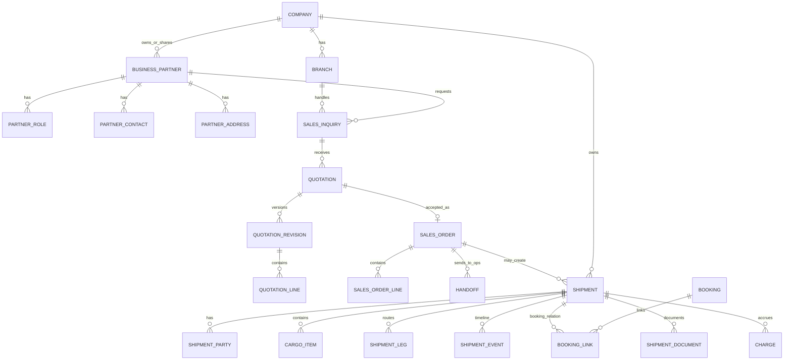
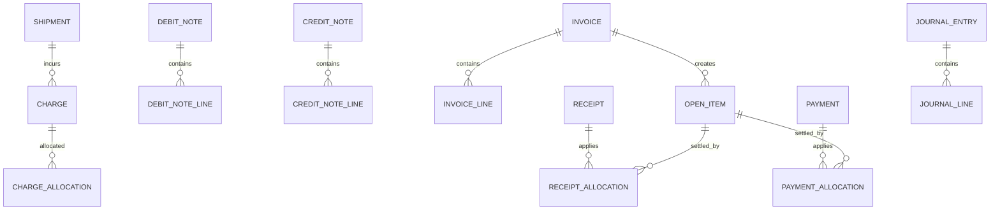

> **Core ERD supersession:** For Core & Master Data cardinalities and constraints, use `06_CORE_MASTER_DATA_ERD.md`. This file remains the conceptual cross-domain overview.

# Conceptual ERD

These diagrams express high-level relationships only; cardinalities and exact FK choices must be reviewed before migrations.

## Core + Sales + Shipment

## Billing / AR/AP (conceptual)

## Relationship guidance
- Prefer explicit link tables for many-to-many relations and historical assignments.
- `shipment_parties` should preserve role and snapshot fields; a partner FK alone is insufficient to preserve what appeared on a document.
- Booking may link multiple shipments only if the operational use case requires shared booking; otherwise simplify to a direct FK initially.
- Consolidation is not the same thing as shipment; link shipments and retain allocation audit records.
