# Core & Master Data — Logical ERD

The diagram is the approved logical target for the Core foundation. `*` means required FK; `o` means nullable FK. Junction tables are explicit where the relationship carries business meaning.

```mermaid
erDiagram
  COMPANIES ||--o{ BRANCHES : owns
  COMPANIES ||--o{ DEPARTMENTS : organizes
  BRANCHES o|--o{ DEPARTMENTS : optionally_hosts
  USERS ||--o{ USER_COMPANY_ACCESS : granted
  COMPANIES ||--o{ USER_COMPANY_ACCESS : grants
  USERS ||--o{ USER_BRANCH_ACCESS : granted
  BRANCHES ||--o{ USER_BRANCH_ACCESS : grants
  COMPANIES ||--o{ BUSINESS_PARTNERS : owns
  BUSINESS_PARTNERS ||--o{ PARTNER_ROLES : has
  BUSINESS_PARTNERS ||--o{ PARTNER_CONTACTS : has
  BUSINESS_PARTNERS ||--o{ PARTNER_ADDRESSES : has
  BUSINESS_PARTNERS ||--o{ PARTNER_CREDIT_PROFILES : configured
  BUSINESS_PARTNERS ||--o{ PARTNER_SALES_ASSIGNMENTS : assigned
  USERS ||--o{ PARTNER_SALES_ASSIGNMENTS : owns
  COUNTRIES ||--o{ LOCATIONS : contains
  LOCATIONS o|--o{ LOCATIONS : parent_of
  COUNTRIES ||--o{ PORTS : contains
  COUNTRIES ||--o{ AIRPORTS : contains
  CURRENCIES ||--o{ COMPANIES : base_currency
  COMPANIES ||--o{ EXCHANGE_RATES : defines
  CURRENCIES ||--o{ EXCHANGE_RATES : from_currency
  CURRENCIES ||--o{ EXCHANGE_RATES : to_currency
  TRANSPORT_MODES o|--o{ SERVICE_TYPES : classifies
  CHARGE_CATEGORIES ||--o{ CHARGE_CODES : groups
  COMPANIES ||--o{ CHARGE_CODES : configures
  COMPANIES ||--o{ PAYMENT_TERMS : configures
  COMPANIES ||--o{ TAX_CODES : configures
  COMPANIES ||--o{ NUMBERING_SEQUENCES : owns
```

## Cardinality and constraints

- Company 1:N Branch; company 1:N Department. A department may be company-wide (`branch_id NULL`) or branch-attached.
- User N:M Company via `user_company_access`; User N:M Branch via `user_branch_access`. A branch grant must belong to a company the user can access.
- Company 1:N Business Partner in v1. Cross-company shared partner master is explicitly not implicit.
- Business Partner 1:N Roles/Contacts/Addresses/Credit Profiles/Sales Assignments.
- Country 1:N Locations/Ports/Airports. Location is hierarchical through nullable `parent_location_id`.
- Company 1:N Exchange Rates; currency is referenced twice with distinct from/to semantics.
- Transport Mode 1:N Service Types (nullable mode permits cross-modal services).
- Charge Category 1:N Charge Codes; Charge Code is company-specific.
- Numbering Sequence belongs to company and optionally branch/document type/period scope.

## Deliberate non-relationships

- Do not connect users directly to one branch as their only branch; use access grants.
- Do not make Customer, Vendor, Agent, Co-loader separate copies of a partner identity; use `partner_roles`.
- Do not use free-text country names on partner addresses; reference `countries` and preserve address text snapshots on transactions.
- Do not use `service_type` to encode IMPORT/EXPORT; direction belongs to shipment/sales workflow.
- Do not create an FK from `numbering_sequences` to every future document table; the document stores the issued number and has its own scoped unique constraint.
